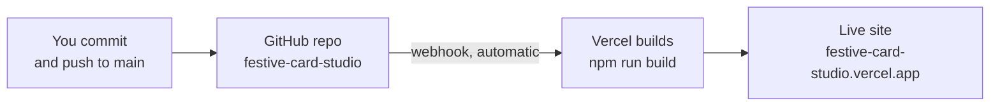

# 1 · Getting started

## What you need

| Tool | Version | Check with |
|---|---|---|
| Node.js | 18 or newer (22 recommended) | `node -v` |
| npm | comes with Node | `npm -v` |
| Git | any recent | `git --version` |
| Editor | VS Code recommended | — |
| Browser | Chrome or Edge (best for GIF/PNG export testing) | — |

## Run it on your computer

```bash
git clone https://github.com/saurabhamrutkar07/festive-card-studio.git
cd festive-card-studio
npm install          # downloads libraries into node_modules/ (first time only)
npm run dev          # starts the dev server → open http://localhost:5173
```

While `npm run dev` is running, **every file you save appears in the browser instantly** (this is called *hot reload*). You don't need to refresh.

> If port 5173 is busy, Vite picks the next one (5174, 5175…). Read the terminal output for the real address.

## The four commands

| Command | What it does | When to use it |
|---|---|---|
| `npm run dev` | Starts the local dev server with hot reload | While coding |
| `npm run build` | Type-checks **and** builds the production site into `dist/` | Before every commit — if this fails, don't push |
| `npm run typecheck` | Only checks TypeScript types (faster) | Quick sanity check |
| `npm run preview` | Serves the built `dist/` folder locally | To test the production build |

## How the live site is deployed



- **There is no manual deploy step.** Pushing to the `main` branch makes Vercel rebuild and publish in about a minute.
- If the Vercel build fails, the old version stays live — check the **Deployments** tab on vercel.com for the error.
- Vercel settings (auto-detected): Framework **Vite**, build `npm run build`, output `dist`, no environment variables.

## Your first change (5-minute exercise)

1. Open `src/data/translations.ts`.
2. Find the English `subheading: 'The Festival of Lights'` and change the text.
3. Save — the live preview updates immediately.
4. Run `npm run build` — it should say `✓ built`.
5. Undo the change.

If that worked, your setup is complete. Next: [High-level design →](02-architecture.md)
