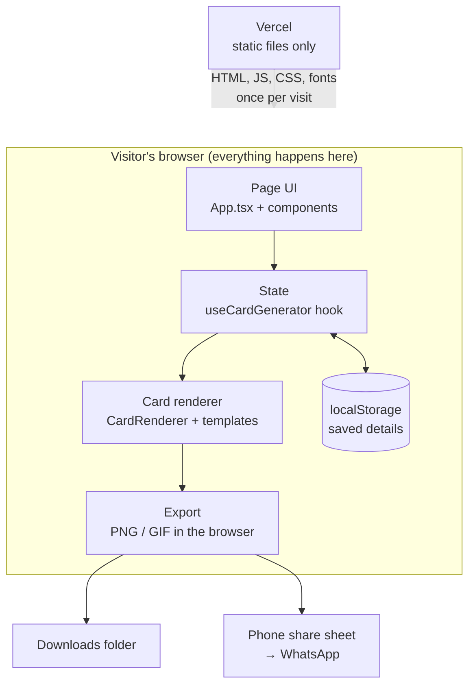
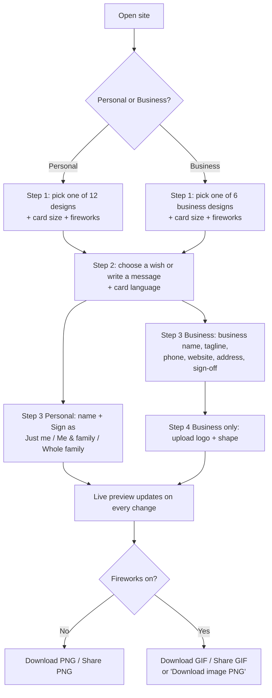
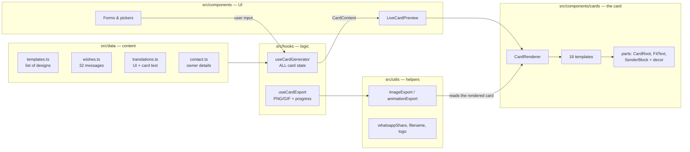

# 2 · High-level design

## What the app does

Festive Card Studio lets anyone create a festival greeting card in **English, Hindi or Marathi** and download or share it.

| Feature | In plain words |
|---|---|
| **Two modes** | *Personal* (signed by a person or family) and *Business* (branded with a company's logo and contact line) |
| **18 designs** | 12 personal templates + 6 business templates |
| **32 wishes** | Ready-made messages in 8 categories, in all 3 languages — or write your own |
| **3 card sizes** | Portrait 1080×1350, Square 1080×1080, Landscape 1920×1080 |
| **Fireworks** | Optional animated bursts and rockets behind the design (Off / Subtle / Grand) |
| **Export** | Still **PNG**, or an **animated GIF** when fireworks are on |
| **Share** | Opens the phone's share menu (WhatsApp etc.) with the image attached |
| **Owner contact** | "Like this website? Let's build yours." section with WhatsApp / Email buttons |

## Tech stack

| Layer | Tool | Why |
|---|---|---|
| UI | **React 18** | Components + state; the card itself is a React component |
| Language | **TypeScript** | Catches mistakes before runtime; every data shape is typed in `src/types/card.ts` |
| Build | **Vite 6** | Fast dev server and production build |
| Styling | **Tailwind CSS 4** for the page UI; **inline styles** inside card templates | Cards need exact pixel sizes, so templates use inline styles |
| Icons | **lucide-react** | Simple stroke icons |
| PNG export | **html-to-image** | Turns the card's HTML into an image |
| GIF export | **gifenc** | Encodes frames into an animated GIF |
| Fonts | **@fontsource/** packages | Fonts are bundled with the site (Latin + Devanagari) |
| Hosting | **Vercel** (free static hosting) | Auto-deploys on push |

## Architecture: no backend



**Consequences you should know:**
- Vercel only serves files — it never sees names, messages or logos. Privacy is automatic.
- Hosting is nearly free (no server to pay for).
- Anything "saved" is saved **in that visitor's browser** (localStorage), not in a database. Clearing browser data clears it.

## User flow (what a visitor does)



## Main building blocks



**In one sentence:** forms update the state in `useCardGenerator` → it builds a `CardContent` object → `CardRenderer` picks the template and draws the card → export utilities photograph that exact card as PNG/GIF.

## Folder map

```
festive-card-studio/
├─ docs/                     ← this handbook
├─ public/favicon.svg
├─ index.html                ← page shell; loads src/main.tsx
├─ package.json              ← scripts + libraries
├─ vite.config.ts            ← build config
└─ src/
   ├─ main.tsx               ← mounts <App /> into the page
   ├─ App.tsx                ← the whole page: sections, steps, download/share handlers
   ├─ index.css              ← fonts, Tailwind theme, fireworks animations
   ├─ types/card.ts          ← ★ every data shape (start here when confused)
   ├─ data/                  ← content: templates, wishes, translations, contact
   ├─ hooks/                 ← logic: useCardGenerator (state), useCardExport (export)
   ├─ utils/                 ← helpers: export, share, filename, logo processing
   └─ components/
      ├─ *.tsx               ← page UI: forms, pickers, buttons, sections
      └─ cards/              ← ★ the card itself
         ├─ CardRenderer.tsx ← chooses the template, adds logo/fireworks layers
         ├─ parts.tsx        ← shared building blocks for templates
         ├─ typography.ts    ← font stacks + user text-style resolution
         ├─ templates/       ← the 18 designs
         └─ decor/           ← SVG art: lamps, florals, patterns, scenes, fireworks
```

Next: [Low-level design →](03-low-level-design.md)
