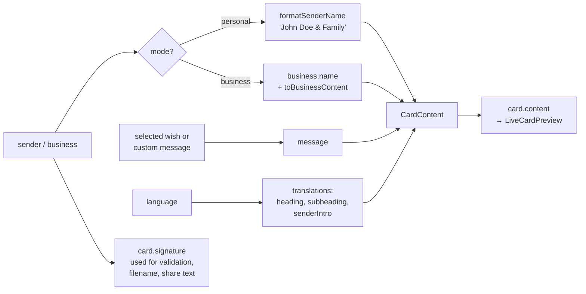
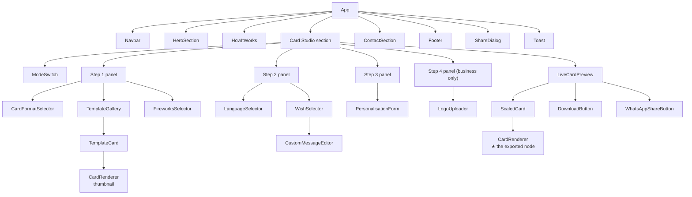
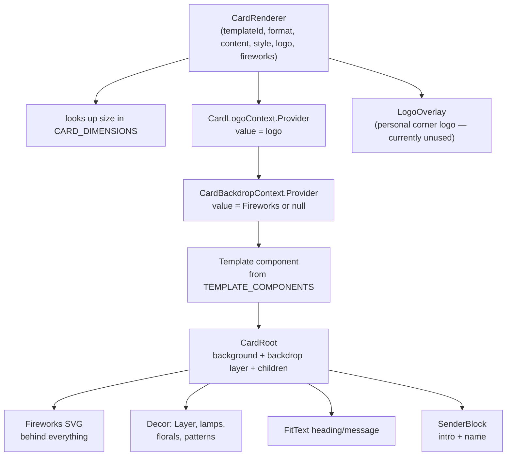
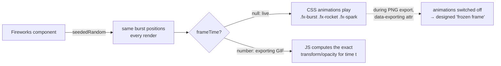
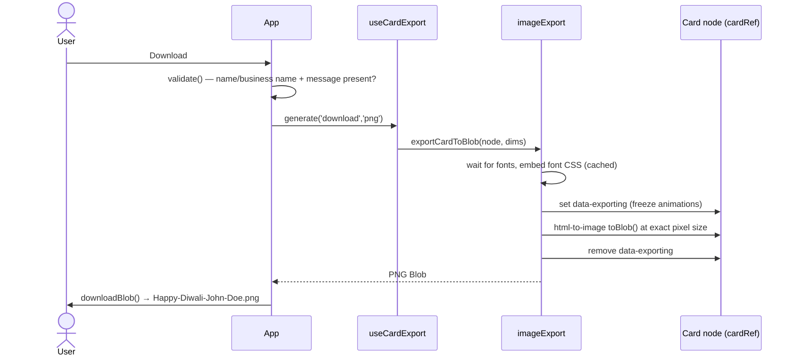
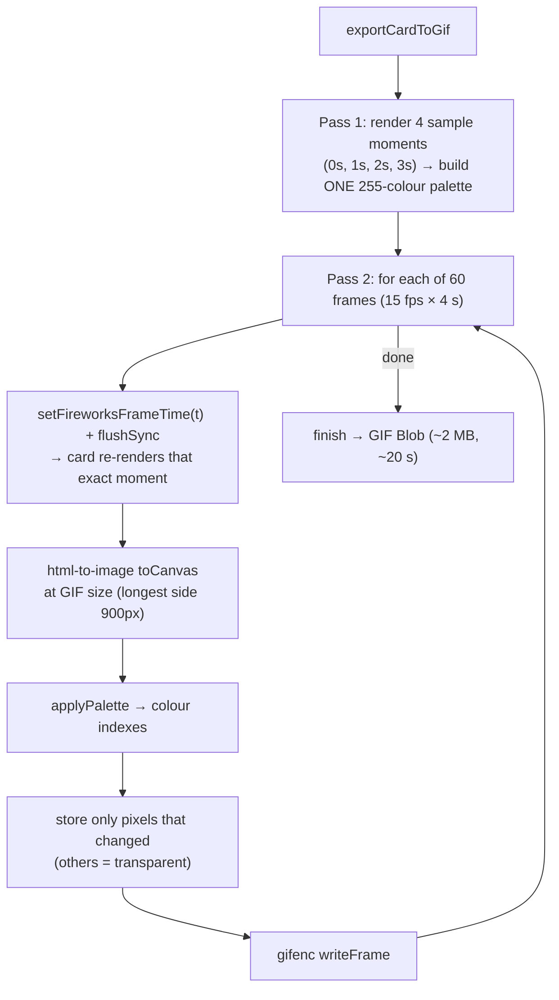
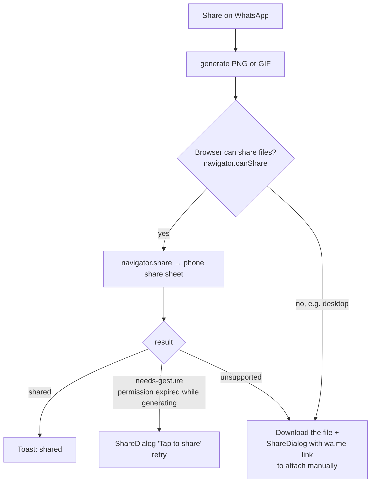
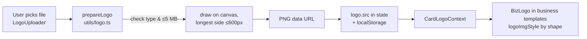

# 3 · Low-level design

This page explains **how the code works, file by file**. Keep `src/types/card.ts` open while reading — every object mentioned here is defined there.

---

## 3.1 The data shapes (`src/types/card.ts`)

| Type | What it represents | Example |
|---|---|---|
| `CardMode` | Personal or business card | `'personal'` |
| `TemplateId` | Which design | `'deepmala'`, `'biz-letterhead-ivory'` |
| `CardTemplate` | Gallery info for a design (name, category, mode, swatch) | entries in `data/templates.ts` |
| `CardFormat` | Card size | `'portrait' \| 'square' \| 'landscape'` |
| `Language` | Card language | `'en' \| 'hi' \| 'mr'` |
| `Wish` | A ready-made message in all 3 languages | entries in `data/wishes.ts` |
| `SenderDetails` | Personal signer: `name`, `signAs`, `customSenderText` | `{ name: 'John Doe', signAs: 'withFamily' }` |
| `SignAs` | How a person signs | `'me' \| 'withFamily' \| 'family'` |
| `BusinessDetails` | Business form: name, tagline, phone, website, address, signoff | — |
| `LogoOptions` | Uploaded logo + `shape`, `size`, `position`, `backdrop` | — |
| `TextStyleOptions` | User's text style: font, size, colour, alignment | — |
| `FireworksLevel` | `'off' \| 'subtle' \| 'grand'` | — |
| **`CardContent`** | ★ **Everything a template needs, already translated and formatted** | see below |

`CardContent` is the contract between the logic and the designs:

```ts
interface CardContent {
  heading: string;        // "Happy Diwali!"  (translated)
  subheading: string;     // "The Festival of Lights"
  message: string;        // the wish or custom message
  senderIntro: string;    // "Happy Diwali Wishes From"  (or user's custom line)
  senderName: string;     // "John Doe & Family"  or  "Sharma Sweets"
  language: Language;
  business?: {            // only on business cards
    name: string; tagline: string;
    contacts: { kind: 'phone' | 'website' | 'address'; text: string }[];
  };
}
```

> **Rule:** templates never compute text themselves. They only *display* `CardContent`. All logic (translation, "& Family", placeholders) happens in the hook.

---

## 3.2 State: `src/hooks/useCardGenerator.ts`

This one hook holds **all** card state. `App.tsx` calls it once: `const card = useCardGenerator();`

### What it stores

| State | Default | Saved in browser? |
|---|---|---|
| `mode` | `'personal'` | no |
| `templateId` | `'deepmala'` | no |
| `format` | `'portrait'` | no |
| `language` | `'en'` | no |
| `messageMode`, `selectedWishId`, `wishCategory`, `customMessage`, `presetEdits` | first wish | no |
| `sender` (name, signAs, customSenderText) | empty | ✅ `diwali-card-sender-v1` |
| `business` (all business fields) | empty | ✅ `festive-card-business-v1` |
| `logo` (image data URL + options) | none | ✅ `diwali-card-logo-v2` |
| `textStyle` | design defaults | no |
| `fireworks` | `'off'` | no |

### What it computes (derived values)



### Important actions

| Action | What it does |
|---|---|
| `setMode(m)` | Switches mode, restores the last template used in that mode, and for business opens the *professional* wishes |
| `setTemplateId(id)` | Selects a design (remembers it per mode) |
| `updateSender(key, v)` / `setSignAs(v)` | Personal form |
| `updateBusiness(key, v)` | Business form (length-limited by `BUSINESS_LIMITS`) |
| `selectWish`, `randomWish`, `editPreset`, `resetPreset`, `setCustomMessage` | Message handling |
| `updateLogo(key, v)` / `removeLogo()` | Logo |
| `updateTextStyle`, `resetTextStyle`, `setFireworks`, `setFormat`, `setLanguage` | Styling |

### `formatSenderName` (personal signature)

| signAs | English | Hindi |
|---|---|---|
| `me` | John Doe | John Doe |
| `withFamily` | John Doe & Family | John Doe एवं परिवार |
| `family` | Doe Family *(last word of the name)* | Doe परिवार |

---

## 3.3 Component tree



- **`TemplateGallery`** shows the designs for the current `mode` (`templatesForMode(mode)`) using sample content.
- **`LiveCardPreview`** holds `cardRef` — a React ref pointing at the real card DOM node. Export functions photograph exactly this node, so **preview = download**.
- **`ScaledCard`** shows the full-size card (e.g. 1080×1350) shrunk with CSS `transform: scale()` to fit the screen. The card itself never changes size.

---

## 3.4 How a card is drawn



### The shared parts (`src/components/cards/parts.tsx`)

| Part | Job |
|---|---|
| `CardRoot` | The card canvas at exact pixel size. Draws the background and the **backdrop** (fireworks) *under* the template's children. |
| `Layer` | An absolutely positioned decorative box. |
| `FitText` | ★ Auto-shrinks text (binary search on font size) until it fits its box. **This is why long messages never overflow.** Use it for any text whose length the user controls. |
| `SenderBlock` | The "From … / Name" block used by all personal templates. |
| `OrnamentDivider` | Small line–diamond–line ornament. |
| `CardLogoContext` / `CardBackdropContext` | React contexts so logo and fireworks reach every template **without changing each template's code**. |

### Typography (`src/components/cards/typography.ts`)

- `FONT_STACKS` pairs each Latin font with a Devanagari font, so Hindi/Marathi always render.
- `resolveTypography(style, defaults)` merges the user's *Text style* choices with the template's defaults → `{ font, color, senderAlign, scale }`.

### Personal vs business templates

| | Personal (`classic/festive/artisticTemplates.tsx`) | Business (`businessTemplates.tsx`) |
|---|---|---|
| Signature | `SenderBlock` | Own layout: logo + name + tagline + `ContactLine` |
| Logo | not shown (personal logos are disabled for now) | `BizLogo` — uploaded logo, or a **monogram of initials** if none |
| Sizing | hand-tuned per format | authored for portrait, scaled by `k = height / 1350` via `useLayout()` |

---

## 3.5 Fireworks (`decor/Fireworks.tsx`, `decor/fireworksClock.ts`, `index.css`)



- **Base style = frozen frame.** Each element's default style shows bursts fully open. CSS animations play *on top* in the live preview.
- **PNG export** adds `data-exporting` to the card → CSS rule turns animations off → the PNG shows the frozen frame.
- **GIF export** sets a global clock (`setFireworksFrameTime(t)`) → `Fireworks` re-renders the exact moment `t` using JS copies of the keyframes (`burstFrame`, `rocketFrame`, `sparkFrame`).
- **Seamless loop:** every animation duration divides `FIREWORKS_LOOP_SECONDS` (4 s), so the GIF loops without a jump.
- Bursts are timed to be *open at t = 0*, so the first frame (used as chat thumbnail) looks complete.

---

## 3.6 Export & share

### PNG — `utils/imageExport.ts`



### GIF — `utils/animationExport.ts`



Why two passes and frame differencing? Keeping all frames in memory would use ~150 MB (too much for phones), and storing only changed pixels keeps the file small enough for WhatsApp.

### Share — `App.tsx handleShare` + `utils/whatsappShare.ts`



---

## 3.7 Logo pipeline (business mode)



`logoShape.ts`: `original` keeps the image as-is; `circle` / `rounded` / `square` crop it to a square and mask it. `logoFrameRadius` makes frames around the logo follow the same shape.

---

## 3.8 File reference (when would I touch this?)

| File | Responsibility | You touch it when… |
|---|---|---|
| `App.tsx` | Page layout, steps, validation, download/share handlers | Adding a page section or a new step; changing button behaviour |
| `types/card.ts` | All data types | Adding any new field/option (always start here) |
| `data/templates.ts` | Design list (name, category, mode), card sizes | Adding/renaming a design |
| `data/wishes.ts` | 32 wishes × 3 languages | Adding/editing messages |
| `data/translations.ts` | Card text + labels per language | Changing wording; adding a language |
| `data/contact.ts` | Owner's name, WhatsApp, email | Changing contact details |
| `hooks/useCardGenerator.ts` | All state + `CardContent` | New option that affects the card |
| `hooks/useCardExport.ts` | Export state (busy, progress) | New export format |
| `components/cards/CardRenderer.tsx` | Template registry + logo/fireworks layers | Registering a new template |
| `components/cards/parts.tsx` | Shared template building blocks | Changing something for *all* personal templates |
| `components/cards/templates/*.tsx` | The designs | Creating/changing a design |
| `components/cards/decor/*.tsx` | SVG art (lamps, florals, patterns, scenes, fireworks) | New decorations |
| `components/PersonalisationForm.tsx` | Step 3 form (personal + business + text style) | New form field |
| `components/LogoUploader.tsx` | Step 4 logo upload + shape | Logo options |
| `components/TemplateGallery.tsx` | Step 1 gallery + sample content | Gallery filters/sample text |
| `utils/imageExport.ts` / `animationExport.ts` | PNG / GIF creation | Export quality, size, speed |
| `utils/whatsappShare.ts` | Web Share API + wa.me links | Share behaviour |
| `utils/filename.ts` | Download filename | Filename format |
| `index.css` | Fonts, Tailwind theme, fireworks keyframes, Hindi letter-spacing fix | Global styles, animations |

Next: [How-to guides →](04-how-to-guides.md)
