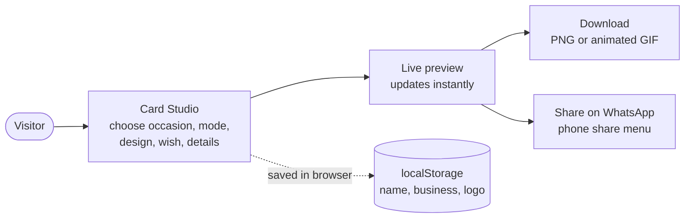

# Festive Card Studio — Developer Handbook (KT)

Welcome! This handbook is for anyone joining the project, **including freshers**. You don't need any prior context: read the pages in order and you will be able to run the app, understand how it works, and make changes safely.

> **The one idea to remember:** this app has **no backend**. Everything — the live preview, PNG/GIF creation, the fireworks — runs **inside the visitor's browser**. There is no server, no database and no login.

## Reading order

| # | Page | Read it when… | Time |
|---|---|---|---|
| 1 | [Getting started](01-getting-started.md) | Day 1 — install, run, build, deploy | 10 min |
| 2 | [High-level design](02-architecture.md) | Day 1 — what the app does and how the pieces fit | 15 min |
| 3 | [Low-level design](03-low-level-design.md) | Day 2 — state, templates, export, file by file | 30 min |
| 4 | [How-to guides](04-how-to-guides.md) | Whenever you get a new requirement | as needed |
| 5 | [Rules, gotchas & glossary](05-gotchas-and-glossary.md) | Before your first pull request | 10 min |

## The app in one picture

## "I got a new requirement — where do I start?"

Jump straight to the matching recipe in [How-to guides](04-how-to-guides.md):

| Requirement sounds like… | Recipe |
|---|---|
| "Add a new card design" | [Add a personal template](04-how-to-guides.md#1-add-a-new-personal-template) |
| "Add a design for businesses" | [Add a business template](04-how-to-guides.md#2-add-a-new-business-template) |
| "Add more wishes / messages" | [Add a wish](04-how-to-guides.md#3-add-a-new-wish) |
| "Support Gujarati / Tamil / …" | [Add a language](04-how-to-guides.md#4-add-a-new-language) |
| "Add Holi / Eid / Christmas" | [Add an occasion](04-how-to-guides.md#5-add-a-new-occasion-festival-day) |
| "Change the owner's WhatsApp / email" | [Change contact details](04-how-to-guides.md#6-change-the-owners-contact-details) |
| "Add a field to the business form" | [Add a business field](04-how-to-guides.md#7-add-a-new-business-detail-field) |
| "Change fireworks / GIF length / quality" | [Tune fireworks & GIF](04-how-to-guides.md#8-tune-fireworks-or-gif-export) |
